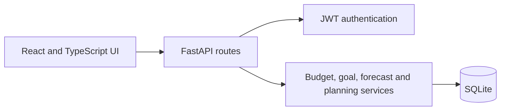

# FinSight AI

A personal finance workspace that brings transaction analytics, budgets, goals, forecasting, financial health scoring, and what-if planning into one application.

**Stack:** React · TypeScript · FastAPI · SQLite · Pandas · Statsmodels

## Features

- Transaction summaries and category-based analytics.
- Budget creation, tracking, and alerts.
- Financial goals and progress tracking.
- Forecasting and financial health breakdowns.
- What-if simulations and affordability planning.
- JWT authentication and account-specific data access.
- Backend tests covering API behavior, domain logic, authentication, and user isolation.

## Architecture



HTTP routes and financial domain services are separate modules. The React client sends bearer tokens through an Axios interceptor and connects to `http://localhost:5000/api` in the current development configuration.

## Run locally

Use Python 3.13 and Node.js 24 LTS for the local setup.

```bash
git clone https://github.com/farazahmed007/FinSight-AI.git
cd FinSight-AI
```

### Start the API

In PowerShell:

```powershell
cd backend
python -m venv .venv
.\.venv\Scripts\python.exe -m pip install -r requirements.txt
$env:JWT_SECRET_KEY = [guid]::NewGuid().ToString('N') + [guid]::NewGuid().ToString('N')
.\.venv\Scripts\python.exe -m uvicorn main:app --host 127.0.0.1 --port 5000 --reload
```

On Linux or macOS, use `.venv/bin/python` in place of the Windows executable path and set `JWT_SECRET_KEY` in your shell environment before starting the API.

API documentation: [http://localhost:5000/docs](http://localhost:5000/docs).

### Start the frontend

In a second terminal, from the repository root:

```bash
cd frontend
npm ci
npm run dev
```

Open the URL printed by Vite. Keep the API on port 5000 to match the current client configuration.

## Run checks

Backend, from `backend/` with the virtual environment active:

```bash
python -m pytest tests
```

Frontend, from `frontend/`:

```bash
npm run lint
npm run build
```

## Repository layout

```text
backend/
  main.py          FastAPI application and local startup
  routes/          Authentication and finance API routes
  services/        Analytics, forecasting, budget, goal and planning logic
  middleware/      Authentication checks
  schemas/         API request and response schemas
  tests/           API, domain and user isolation tests
  data/            SQLite data and sample transactions
frontend/
  src/             React pages, components and API client
  package.json     Development, lint and build commands
```

## Current scope

FinSight is an application prototype for local exploration. Its current setup uses SQLite, permissive development CORS, and a localhost API URL. A hosted deployment would need explicit CORS origins, an environment-specific API URL, managed secrets, and an appropriate database and backup strategy.

Forecasts and scores demonstrate the application's planning features and depend on the available input data.
